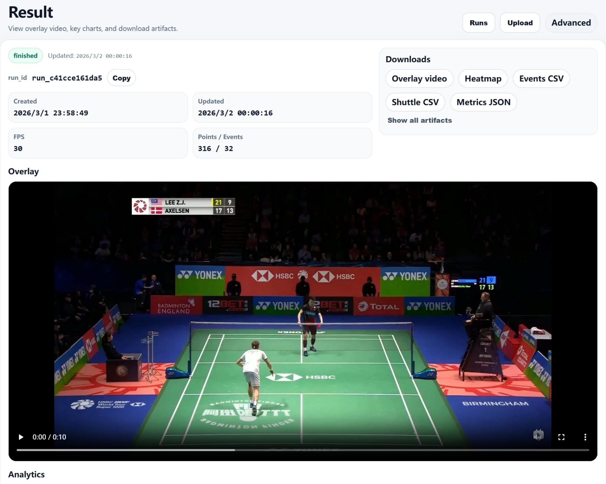

# Badminton Performance Analyzer

A prototype that connects badminton shuttlecock tracking, trajectory analysis and a browser-based results dashboard.

The full workflow accepts a video, uses the third-party TrackNetV3 model to generate trajectory data, estimates rallies and hit events, and saves each analysis as a separate run. The interface uses Angular and FastAPI; an additional Streamlit dashboard supports visual exploration.



*Figure 5-1 from the final-year thesis: the Angular result page for a completed analysis, showing video playback, run metadata and downloadable CSV/JSON and visual outputs. Historical prototype screenshot; displayed event counts are estimates, not accuracy measurements.*

## Implemented features

- Video upload, processing status and navigation between saved runs.
- TrackNetV3 inference integration and normalisation of its CSV output.
- Visibility-based rally segmentation and heuristic hit-event estimation.
- Rally duration and estimated hit-count summaries.
- Trajectory overlays, image-space trajectory visualisation and optional court mapping.
- CSV/JSON exports and run-based artefact storage.

Player detection, pose estimation and tactical interpretation were not completed.

## Workflow and structure

```text
Video -> FastAPI job -> TrackNetV3 -> trajectory CSV
      -> Python analytics -> per-run artefacts -> Angular / Streamlit
```

| Directory | Role |
| --- | --- |
| `badminton-fullstack-a1/frontend/` | Angular upload, job, run-list and result pages |
| `badminton-fullstack-a1/backend/` | FastAPI routes, SQLite metadata and pipeline integration |
| `badminton-performance-analyzer/` | Python analytics, visualisations and Streamlit dashboard |
| `TrackNetV3/` | Third-party model source; see its original README and licence |
| `examples/sample_run/` | Small archived outputs from the submitted project |
| `docs/` | Setup, evaluation and contribution notes |

## Try the analysis without a GPU

From the repository root, using Python 3.10-3.12:

```powershell
python -m venv .venv
.\.venv\Scripts\python.exe -m pip install --no-compile -r badminton-performance-analyzer/requirements.txt
.\.venv\Scripts\python.exe badminton-performance-analyzer/scripts/demo.py
```

The demo replays the archived trajectory CSV against a locally generated, clearly labelled synthetic background. It runs the actual analysis pipeline and saves output under `badminton-performance-analyzer/outputs/run_sample/`. It does not perform model inference or redistribute the original match footage.

Inspect the generated results:

```powershell
.\.venv\Scripts\python.exe -m streamlit run badminton-performance-analyzer/dashboard/app_multi.py -- --runs_root badminton-performance-analyzer/outputs
```

For your own video and a precomputed CSV:

```powershell
.\.venv\Scripts\python.exe badminton-performance-analyzer/scripts/run_pipeline.py --video path/to/match.mp4 --shuttle_csv path/to/shuttle.csv --out badminton-performance-analyzer/outputs/run_custom
```

CSV columns must include `Frame`, `Visibility`, `X` and `Y`. Coordinates are image pixels and frame numbers are zero-based.

## Run the complete application

See [setup instructions](docs/SETUP.md) for environments, model weights, FFmpeg and the Windows launcher. The complete application additionally requires Node.js, backend dependencies and a separate TrackNetV3 environment. Large model checkpoints, virtual environments, videos, databases and generated outputs are intentionally excluded from Git.

Local addresses after startup:

- Angular: `http://127.0.0.1:4200/upload`
- FastAPI: `http://127.0.0.1:8000/docs`
- Streamlit: `http://127.0.0.1:8501`

## Example and evaluation

The archived example has 316 frames at 30 FPS. The pipeline reports one rally, 32 estimated hit events and a duration of approximately 10.53 seconds. These are software outputs, not manually verified match statistics or ground truth. The small example files document a completed processing run; they do not establish tracking accuracy or generalisation.

See [evaluation and limitations](docs/EVALUATION.md) for the original evaluation scope and the checks added when preparing this public repository.

Known limitations include motion blur, occlusion, camera changes, heuristic event detection and the absence of a comprehensive labelled evaluation dataset. Outputs are for prototype exploration and require manual checking.

## Contribution and attribution

My project work focuses on connecting the model to a usable analysis system: backend and frontend integration, run management, trajectory processing, rally/event estimation, metrics and visual outputs. TrackNetV3 is an existing model, not a model developed or trained from scratch for this project. See [contribution details](docs/CONTRIBUTIONS.md).

TrackNetV3 source is adapted from [qaz812345/TrackNetV3](https://github.com/qaz812345/TrackNetV3), corresponding to [TrackNetV3: Enhancing Shuttlecock Tracking with Augmentations and Trajectory Rectification](https://doi.org/10.1145/3595916.3626370). Its [MIT licence](TrackNetV3/LICENSE) is retained. The original training, evaluation and corrected-label files are upstream material, not evidence of my own training or annotation work.

AI-assisted code refinement was acknowledged in the submitted report. Existing third-party notices remain applicable; no new repository-wide licence is asserted here.

## Checks

Run the startup/path regression checks from the repository root:

```powershell
python -m unittest discover -s tests -v
```

The CPU demo additionally checks that regenerated metrics and events match the archived example. See the evaluation notes for the verification scope.
